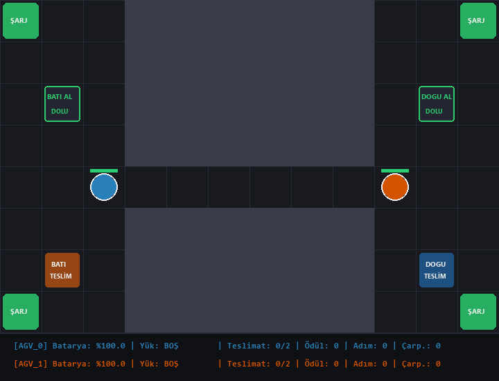
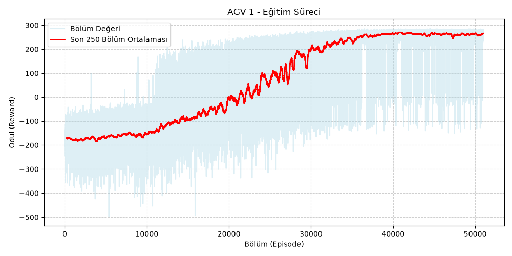
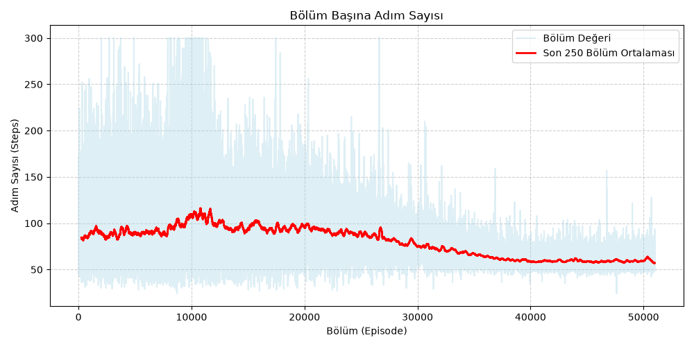

# Çoklu Ajanlı Pekiştirmeli Öğrenme ile Çift Döngülü Endüstriyel AGV Filo Yönetimi ve Kilitlenme (Deadlock) Önleme

## 1. Özet (Abstract)
Modern akıllı üretim tesislerinde ve lojistik depolarında Otonom Yönlendirmeli Araçların (AGV - Automated Guided Vehicle) operasyonel verimliliği; tek şeritli koridorlardaki kilitlenmelerin (deadlock) önlenmesine ve boş geri dönüşlerin (deadheading) asgari düzeye indirilmesine bağlıdır. Karşı yakaya teslimat gerçekleştiren bir aracın boş dönmek yerine, o bölgede hazır bulunan yeni siparişi alıp kendi bölgesine taşıması (**Opportunistic Backhauling / Çift Döngülü Taşıma**), hat kapasitesini iki katına çıkarırken trafik sıkışıklığını minimize eder.

Bu projede, dar geçitli bir fabrika ortamında iki bağımsız AGV'nin **Çoklu Ajanlı Pekiştirmeli Öğrenme (Multi-Agent Q-Learning)** ile eğitildiği dinamik bir filo yönetim sistemi geliştirilmiştir. Sistemde araçlar merkezi bir kontrolcüye ihtiyaç duymadan, kısıtlı yerel algılama (LiDAR menzili) altında birbirlerine öncelik tanıyarak tek şeritli koridordan güvenle geçmekte; dururken, boşken ve yüklüyken gerçekçi batarya tüketim dinamiklerini gözeterek görevlerini sıfır kilitlenme ve sıfır kaza ile tamamlamaktadır.



*Şekil 1: Çift döngülü akıllı AGV simülasyon ortamı, tek şeritli koridor darboğazı, yük istasyonları ve batarya şarj noktaları.*


## 2. MDP (Markov Karar Süreci) Tasarımı

Sistem, dağıtık (decentralized) ve kısmi gözlemlenebilir çoklu ajan yapısında modellenmiştir:

### Durum Uzayı (State Space)
Ajanların durum temsili hem yön bulmayı hem de komşu aracı fark etmeyi sağlayacak şekilde 8 genel değişkenden oluşur:
* **Konum ($x, y$):** Aracın fabrika ızgarasındaki güncel koordinatları.
* **Yük Durumu ($payload$):** Yüksüz (0), Batıdan Doğuya taşınan yük (1), Doğudan Batıya taşınan yük (2).
* **Görev Fazı ($teslimat$):** Aracın tamamladığı teslimat sayısı (gidiş teslimatı mı, dönüş teslimatı mı?).
* **Batarya Seviyesi ($bat\_level$):** Kritik ($\le \%25$), Orta ($\le \%50$) ve Yüksek enerji durumu.
* **Komşu AGV Göreli Konumu ($rel\_other$):** Komşu araç $\pm 2$ hücrelik yerel sensör menzilindeyse bağıl konumu $(dx, dy)$, uzaktaysa güvenli mesafe bilgisi.
* **Koridor Durumu ($corr\_other$):** Karşıdaki aracın tek şeritli koridorda olup olmadığı ve hangi yöne gittiği.
* **İstasyon Stok Durumu ($stok$):** Bulunulan yakadaki alım noktasında yeni yük hazır mı?

### Eylem Uzayı (Action Space)
Her ajan için 5 ayrık (discrete) eylem tanımlıdır:
* `0 - (Bekle / Yol Ver / Şarj Ol):` Koridor ağzında karşıdaki araca geçiş önceliği verir; şarj hücresindeyse bataryayı doldurur.
* `1 - Yukarı`, `2 - Aşağı`, `3 - Sol`, `4 - Sağ:` Izgara üzerinde birer hücre yönlü hareket.

### Politika (Policy)
* **Öğrenme ve Karar:** Model bağımsız Q-Learning (Decentralized Q-Learning) ile eğitilmiştir.
* **Keşif Stratejisi:** Eğitim süresince doğrusal olarak azalan $\epsilon$-greedy politikası ($\epsilon: 1.0 \rightarrow 0.02$) uygulanmıştır. Test aşamasında ise tamamen greedy ($\epsilon = 0$) deterministik politika kullanılır.

### Ödül Mekanizması (Reward Function)
Sistemin verimli çalışması, zamanı iyi kullanması ve işbirliği yapması için tasarlanan ödül yapısı:

| Olay / Durum | Ödül Puanı | Açıklama |
|---|:---:|---|
| **Zaman Maliyeti (Adım)** | `-1.0` | Aracın oyalanmasını engelleyip en kısa rotayı seçmeye zorlar. |
| **Bireysel Teslimat** | `+100.0` | Yükün hedef depoya başarıyla ulaştırılması. |
| **Ortak (Takım) Ödülü** | `+30.0` | Takım arkadaşı teslimat yaptığında verilir (işbirlikçi davranış). |
| **Görev Tamamlama Bonusu** | `+50.0` | Çift döngüyü (2 tam gidiş-dönüş teslimatını) bitirme ödülü. |
| **Çarpışma / Kilitlenme Girişimi** | `-40.0` | Hareket iptal edilir; yol verme ve bekleme teşvik edilir. |
| **Yolda Batarya Bitmesi** | `-100.0` | Görevin başarısızlıkla sonlanması (ağır ceza). |

---

## 3. Endüstriyel Dinamikler ve Kilitlenme (Deadlock) Çözümü

1. **Çift Döngülü Taşıma (Opportunistic Backhauling):**
   * Doğu Depoya (`10, 6`) yük getiren AGV boş dönmez; hemen yanındaki Doğu Alma (`10, 2`) noktasından batıya gidecek hazır parçayı sırtlar.
   * Aynı şekilde batıya teslimat yapan diğer AGV de dönüş yükünü alarak fabrika taşıma kapasitesini ikiye katlar.
2. **Kilitlenme (Deadlock) ve Öncelik Yönetimi:**
   * Koridor tek şeritli olduğu için iki araç aynı anda karşı karşıya gelemez.
   * Ajanlar, komşu aracın koridorda olduğunu yerel sensör ufku ($\pm 2$) içinde algıladığında koridor ağzındaki güvenli alanda bekleyip (`Action 0`) karşıdakine yol vermeyi otonom olarak öğrenmiştir.
3. **Gerçekçi Fiziksel Batarya Modeli:**
   * **Yüksüz Seyir Tüketimi:** `1.0` birim/adım
   * **Yüklü Taşıma Tüketimi:** `2.0` birim/adım
   * **Dururken / Beklerken Tüketim:** `0.5` birim/adım (Endüstriyel bilgisayar, LiDAR, emniyet sensörleri ve fren tutucuların sürekli enerji harcaması)
   * **Şarj İstasyonu Dolumu:** Şarj hücresinde `Bekle` eylemi uygulandığında adım başı `+%20` batarya dolumu.

---

## 4. Eğitim ve Performans Grafikleri

Model 60.000 bölüm boyunca eğitilmiş ve test ortamında değerlendirilmiştir.

### A. Ajan Ödül Grafikleri (Reward Convergence)
Ajanların bölüm başına kazandığı net ödül; eğitimin başında rotayı bilmedikleri ve adım/çarpışma cezası aldıkları için `-200` bandındadır. Görev başarıyla öğrenildikçe kararlı bir şekilde yükselerek teorik optimum olan **`+270` puan platosuna** oturmuştur.


*Şekil 2: AGV 0 için bölüm bazlı ödülün yakınsama eğrisi.*



*Şekil 3: AGV 1 için bölüm bazlı ödülün yakınsama eğrisi.*

---

### B. Teslimat Başarısı ve Adım Sayısı Grafikleri
* **Bölüm Başına Teslimat:** Eğitim başında 0 olan teslimat sayısı, politikanın oturmasıyla birlikte maksimum kapasite olan **4/4 teslimata** (her iki aracın çift döngüsü) ulaşmıştır.
* **Adım Sayısı:** Başlangıçta 400 adımda zaman aşımına (timeout) uğrayan rotalar, optimum bekleme ve sürüş ile **~54 adıma** optimize edilmiştir.


*Şekil 4: Bölüm başına toplam tamamlanan teslimat sayısı (Hedef: 4).*



*Şekil 5: Bölüm başına harcanan adım sayısının en kısa rotaya (~54 adım) inmesi.*

---

### C. Test Başarı İstatistiği (300 Test Bölümü)
* **Sabit Başlangıç:** 300 / 300 bölümde (%100) çift teslimat sıfır kilitlenme ve sıfır kaza ile tamamlandı.
* **Rastgele Başlangıç ve Rastgele Batarya:** 293 / 300 bölümde (%97.7) tam başarı sağlandı.

---

## 5. Kurulum ve Canlı Çalıştırma

### Gereksinimler
```bash
pip install numpy matplotlib pygame pettingzoo gymnasium
```

### Canlı Simülasyonu Başlatma (Görsel Test)
Eğitilmiş en iyi model ağırlıklarıyla (`q_table.pkl`) araçların koridorda birbirine yol verişini ve yük döngüsünü canlı izlemek için:
```bash
python test.py
```

### Modeli Yeniden Eğitme
```bash
python train.py
```
