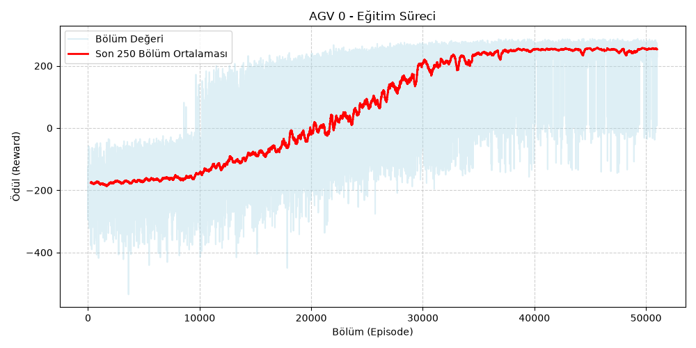
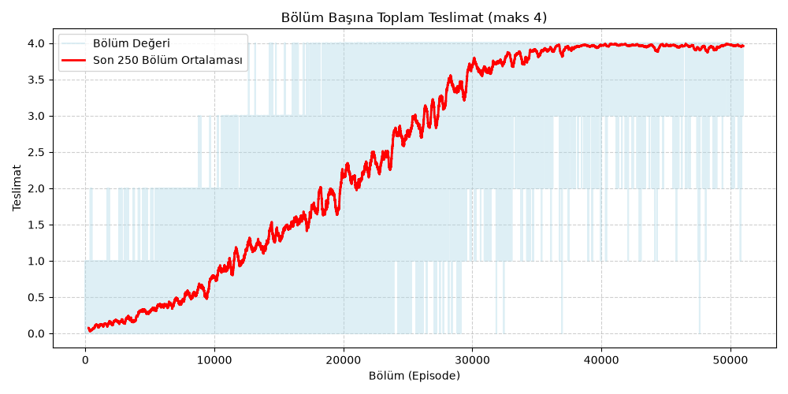
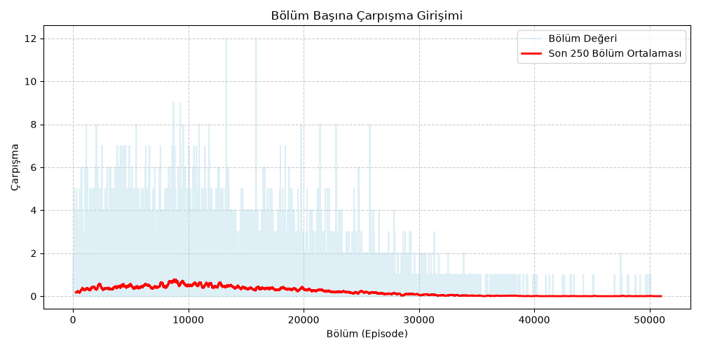

# Çoklu Ajanlı Pekiştirmeli Öğrenme ile Çift Döngülü Endüstriyel AGV Filo Yönetimi ve Kilitlenme Önleme

## 1. Özet

Akıllı üretim tesislerinde ve depolarda Otonom Yönlendirmeli Araçların (AGV) verimliliği; tek şeritli koridorlardaki kilitlenmelerin önlenmesine ve boş dönüşlerin (deadheading) azaltılmasına bağlıdır. **Çift döngülü taşıma (Opportunistic Backhauling)** ile karşı yakaya teslimat yapan araç boş dönmez, o yakadaki hazır yükü alıp kendi yakasına getirir.

Bu projede dar geçitli bir fabrika ortamında iki bağımsız AGV, **merkezi kontrolcü olmadan** (Decentralized Tabular Q-Learning) eğitilmiştir. Ajanlar kısıtlı yerel algılama altında birbirine yol vermeyi, batarya durumuna göre şarj olmayı ve iki teslimatlık görevi tamamlamayı öğrenir.


*Şekil 1: Çift döngülü akıllı AGV simülasyon ortamı, tek şeritli koridor darboğazı, yük istasyonları ve batarya şarj noktaları.*

## 2. Ortam

| Öğe | Değer |
|---|---|
| Izgara | 12 × 8 |
| Duvarlar | x = 3..8 sütunları (y = 4 hariç) |
| Koridor | (3..8, 4), 6 hücre, tek şeritli |
| Şarj hücreleri | (0,0), (11,0), (0,7), (11,7) |
| Batı alım / Doğu teslim | (1,2) / (10,6) |
| Doğu alım / Batı teslim | (10,2) / (1,6) |
| Başlangıç | agv_0: (2,4), agv_1: (9,4) |
| Maks. adım | 300 (zaman aşımı) |
| Stok yenilenmesi | Boş istasyona adım başı %14 olasılıkla yeni yük gelir |

**Görev:** Her AGV 2 teslimat yapar (gidiş + dönüş yükü). Bölüm, iki araç da görevi bitirince, batarya bitince veya zaman aşımında sona erer.

## 3. MDP Tasarımı

### 3.1 Durum Uzayı

Durum uzayı, ajanın karar verirken gördüğü bilgilerin tamamıdır. Aşağıdaki 8 değişken, Q-tablosunda her satırı oluşturan `(x, y, payload, deliveries, bat_level, rel, corr, relevant_stock)` durumunu tanımlar.

#### Değişkenlerin açıklaması

| Değişken | Türkçe anlamı | Alabileceği değerler | Neden gerekli? |
|---|---|---|---|
| `x` | Aracın yatay konumu (sütun) | 0 – 11 (0: en batı, 11: en doğu) | Ajanın haritası yoktur, hedefe yönelmek ve duvarları öğrenmek için nerede olduğunu bilmelidir. |
| `y` | Aracın dikey konumu (satır) | 0 – 7 (0: en üst, 7: en alt) | Aynı. Koridor y = 4 satırındadır. |
| `payload` | Taşınan yük durumu | **0**: boş<br>**1**: Batı→Doğu yükü taşıyor<br>**2**: Doğu→Batı yükü taşıyor | Hedefi belirler: boşsa alım noktasına, 1 ise doğu teslim noktasına, 2 ise batı teslim noktasına gider. Batarya tüketimi de yüke göre değişir. |
| `deliveries` | Tamamlanan teslimat sayısı (görev aşaması) | **0**: henüz teslimat yapmadı<br>**1**: en az 1 teslimat yaptı | Görevin hangi aşamada olduğunu ayırt eder. 2. teslimat bölümü bitirdiği için "2" değeri durumda hiç görülmez. |
| `bat_level` | Batarya seviyesi (3 kademe) | **0**: kritik (≤ 25)<br>**1**: orta (26 – 50)<br>**2**: yüksek (> 50) | Ham değer yerine 3 kademe kullanılır, tablo küçük kalır. Kritik seviyede ajan şarj hücresine yönelmeyi öğrenir. |
| `rel` | Diğer aracın bana göre yeri | **(dx, dy)**: diğer araç ±2 hücre yakınımdaysa yatay ve dikey uzaklığı (örn. (2, 0): 2 hücre sağımda)<br>**(9, 9)**: diğer araç yakında değil veya görevini bitirmiş | Çarpışmadan kaçınmak için. Menzil dışı tüm durumlar tek bir değerde toplandığı için durum sayısı patlamaz. |
| `corr` | Koridor doluluk sinyali: diğer araç koridorda mı, ne taşıyor? | **0**: diğer araç koridorda değil (veya yok)<br>**1**: diğer araç koridorda ve **boş** (yönü kesin belli değil)<br>**2**: diğer araç koridorda ve **Batı→Doğu** yükü taşıyor (doğuya gidiyor)<br>**3**: diğer araç koridorda ve **Doğu→Batı** yükü taşıyor (batıya gidiyor) | Koridor 6 hücre, sensör ±2 hücredir. Koridorun ortasındaki araç `rel` ile görünmeyebilir. `corr` bu boşluğu kapatır ve yük üzerinden yön ipucu verir. Karşı yöne gidiyorsa yol verme (eylem 0) kararının temelidir. |
| `relevant_stock` | Bulunduğum yakadaki alım noktasında yük hazır mı? | **0**: stok yok, yük henüz gelmedi<br>**1**: yük hazır | `x ≤ 5` ise batı alım istasyonu, `x ≥ 6` ise doğu alım istasyonu dikkate alınır. Yük hazır değilse alım noktasında beklemek, hazırsa gidip almak gerekir. Diğer yakadaki stok durumdan çıkarılmıştır. |

#### Neden `corr` değişkeni de var? Sensör yetmez mi?

1. **Menzil sınırı:** Koridor 6 hücre uzunluğunda, sensör ±2 hücre görür. Koridor ağzında (x = 2) duran ajan en fazla x = 4'e kadar görür. Karşıdaki araç x = 5 – 8 arasındaysa `rel` "uzak" döner, ama koridor doludur ve girmek kafa kafaya kalmak demektir.
2. **Yön bilgisi:** `rel` yalnızca "komşu şurada" der, "hangi yöne gidiyor" demez. Tabular Q-learning'de hız veya geçmiş yoktur. `corr` yük bilgisi üzerinden gidiş yönünü ima eder.
3. **Durum sadeleştirme:** Birçok `(dx, dy)` kombinasyonunu ezberlemek yerine "koridorda karşı yönde biri var mı" tek bir değişkende özetlenir.

> **Not:** `corr`, diğer aracın gerçek konumundan hesaplanır ve menzil sınırı yoktur. Yani saf LiDAR bilgisi değil, **hafif bir trafik/doluluk sinyalidir** (gerçek sistemlerdeki zone-blocking benzeri). Sistem bu nedenle "yalnızca yerel sensör" değil, "yerel sensör + koridor doluluk sinyali" ile çalışır.

### 3.2 Eylem Uzayı

| Eylem | Anlam |
|---|---|
| 0 | Bekle / Yol ver / Şarj ol (şarj hücresindeyse +%20 batarya) |
| 1, 2, 3, 4 | Yukarı, Aşağı, Sol, Sağ (bir hücre) |

### 3.3 Ödül Fonksiyonu

| Olay | Ödül | Açıklama |
|---|---|---|
| Adım | -1.0 | Her adımda. En kısa rotayı teşvik eder. |
| Duvara/sınıra hareket | -1.0 | Hareket iptal edilir, araç yerinde kalır. Bölüm sonlanmaz. |
| Yük alma | +10.0 | Alım noktasında stok varken yük alınması |
| Bireysel teslimat | +100.0 | Yükün hedef noktaya ulaşması |
| Takım ödülü | +30.0 | Takım arkadaşı teslimat yapınca |
| Görev tamamlama | +50.0 | 2. teslimatın bitmesi |
| Çarpışma girişimi | -40.0 | İki araç aynı hücreye girmeye veya yer değiştirmeye çalışırsa, hareket eden araca verilir ve hareket iptal edilir |
| Batarya bitmesi | -100.0 | Bölüm sonlanır |

**Tasarım notu:** Duvar hatası telafi edilebilir olduğu için bölümü bitirmez, küçük ceza yeterlidir. Erken sonlandırma, rastgele keşfin yaşandığı eğitim başlangıcında öğrenmeyi zorlaştırırdı. Bölümü sonlandıran tek durum, kurtarılamaz olan batarya bitmesidir.

### 3.4 Ödül Şekillendirme

Asıl ödüller (teslimat, bonus) seyrek olduğu için eğitimin başında ajan neyi doğru yaptığını anlayamaz. Bunu çözmek için ajana, aktif hedefine yaklaşırken küçük bir ek ödül, uzaklaşırken küçük bir ceza verilir (potansiyel tabanlı şekillendirme, `F = γ·Φ(s') − Φ(s)`). Hedef; yüksüzken alım noktası, yüklüyken teslim noktası, batarya kritikken şarj hücresidir. Bu yöntem en iyi politikayı değiştirmeden öğrenmeyi hızlandırır. Ek ödül yalnızca eğitimde kullanılır, grafiklerdeki ödüle dahil değildir.

## 4. Eğitim

| Parametre | Değer |
|---|---|
| Algoritma | Bağımsız (decentralized) tabular Q-Learning, ajan başına ayrı Q-tablosu |
| Öğrenme oranı (α) | 0.1 |
| İndirim (γ) | 0.97 |
| Keşif | ε-greedy, 1.0 → 0.02, ilk %80 bölümde (48.000) doğrusal azalır, sonra 0.02'de sabit |
| Toplam bölüm | 60.000 |
| Müfredat | İlk %15 bölüm (9.000) tek ajanlı (solo), sonrasında iki ajan |
| Rastgele başlangıç | Bölümlerin %50'sinde. Konum rastgele (batı x≤2, doğu x≥9) ve batarya 40-100 arası |
| Test | Tamamen greedy (ε = 0). Görülmemiş durumda rastgele eylem seçilir. |

Gelen bilgiler yalnızca iki ajanlı aşamadan kaydedilir, bu yüzden grafikler 9.001. bölümden başlar.

## 5. Sonuçlar

### 5.1 Ödül Yakınsaması

Eğitim başında ajanlar rotayı bilmediği için ödül yaklaşık -200 bandındadır. Eğitim ilerledikçe kararlı biçimde yükselir ve yaklaşık +270 platosuna oturur (şekillendirme hariç, bölüm başına). Kabaca hesap: 2 teslimat (200) + takım ödülleri (60) + görev bonusu (50) + yük alma (20) = 330, adım cezaları düşülünce ≈270.



*Şekil 2: AGV 0 için bölüm bazlı ödülün yakınsama eğrisi.*


*Şekil 3: AGV 1 için bölüm bazlı ödülün yakınsama eğrisi.*

### 5.2 Teslimat ve Adım Sayısı

- **Teslimat:** Bölüm başına teslimat sayısı en yüksek kapasite olan 4/4'e ulaşır.
- **Adım:** Başlangıçta zaman aşımına (300 adım) uğrayan bölümler, optimum bekleme ve sürüşle yaklaşık 54 adıma iner.



*Şekil 4: Bölüm başına toplam tamamlanan teslimat sayısı (Hedef: 4).*


*Şekil 5: Bölüm başına harcanan adım sayısının en kısa rotaya (~54 adım) inmesi.*



*Şekil 6: Bölüm başına çarpışma girişimi sayısı.*

### 5.3 Test (300 bölüm)

| Senaryo | Başarı |
|---|---|
| Sabit başlangıç | 300 / 300 (%100) |
| Rastgele başlangıç + rastgele batarya | 293 / 300 (%97.7) |

**Başarı tanımı:** Tüm teslimatların 300 adım içinde tamamlanması ve batarya bitmemesi. Kodda ayrı bir deadlock dedektörü yoktur, kilitlenme zaman aşımı olarak görünür.

## 6. Sınırlılıklar

- **Haritaya özgüdür.** Tabular Q-learning hücre bazlı öğrenir. Duvarlar gözlemde yoktur, deneyimle ezberlenir, bu yüzden başka bir haritaya genellenmez.
- **Ölçeklenebilirlik.** Ajan sayısı veya harita büyürse durum uzayı hızla büyür. Derin RL (MAPPO, QMIX vb.) gerekir.
- **Koridor sinyali.** `corr` değişkeni menzil sınırı olmayan bir doluluk bilgisidir, tamamen yerel algılama değildir.
- **Görülmemiş durumlar.** Test sırasında Q-tablosunda olmayan bir durumda rastgele eylem seçilir, rastgele başlangıçtaki başarısız bölümlerin bir nedeni bu olabilir.

## 7. Kurulum ve Çalıştırma

```bash
pip install numpy matplotlib pygame pettingzoo gymnasium
```

```bash
python train.py   # eğitim, q_table.pkl ve grafikleri üretir
python test.py    # eğitilmiş modeli görsel olarak çalıştırır
```

## 8. Dosya Yapısı

| Dosya | Görev |
|---|---|
| `agv_env.py` | PettingZoo ortamı, durum ayrıklaştırma, ödül ve şekillendirme |
| `train.py` | Q-Learning eğitimi, grafik üretimi |
| `test.py` | Eğitilmiş tabloyla greedy test |
| `viewer.py` | Pygame görselleştirme |